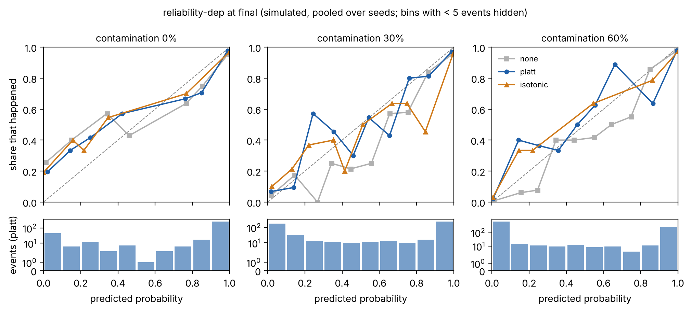

# 3 · Fusion: evidence under conflict

**Role:** ⭐ **research core (Q1 paper)** · **Spec:** §5.1 (RQ2–RQ5), §7 · **Status:** evaluation harness, contamination simulator, copy detection, baselines B3–B5, a dependence-aware reliability model (RQ2, RQ4), detail-level conflict detection with the six-label assessment (RQ3), and the calibration study (RQ5); checked on simulated data only. The LLM baseline (B6) and real-data runs are next.

Given an event and its observations, decides **which sources are really independent, where they conflict, and how certain the assessment is**, and keeps those answers calibrated as the information gets noisier.

## In → out

| In | Out (schema v1) |
|---|---|
| Event cluster + observations + sources | `dependences`: who copied whom (`verbatim_copy`, `rewrite`, `repost`, `cites`, `same_media`) |
| | `relations`: stance and per-attribute `conflicts` |
| | Assessment over time: `verified` / `partially_verified` / `conflicting` / `unverified` / `refuted` / `insufficient_evidence`, with a **calibrated probability** |

## Research questions

- **RQ2:** Does modelling source dependence beat treating every source as independent?
- **RQ3:** Does explicit conflict detection reduce wrong assessments?
- **RQ4:** How fast does performance degrade as contamination rises from 0 % to 60 %?
- **RQ5:** Are the probabilities calibrated, and do multi-state outputs beat a single confidence score?

## What is built

| Part | File | What it does |
|---|---|---|
| Loading | `carcux_fusion/data.py` | Reads a CARCUX-BD export: for each event, whether it happened (`ground_truth.occurred`) and every linked observation as a vote (supports and partly supports +1, contradicts −1); sources and their types; gold dependences. |
| Task | `evaluate.py` | For each event, at T+1h, T+6h, T+24h and final (7 days) after its first observation, the probability it really happened from the evidence published by then. Events in 5 seeded folds; everything learned (source reliability, copy threshold, calibration) comes from the other folds. |
| Metrics | `metrics.py` | Brier score, log loss, expected calibration error (10 equal-width bins, and adaptive: 10 equal-count bins), accuracy, AUC, reliability-diagram bins. Brier differences between methods get a paired bootstrap over events (95 % interval, p). |
| Copy detection | `dependence.py` | Each item against earlier items about the same event: character n-gram text overlap, attribution phrases ("according to", "er moto", "এর মতে", "RT", …), perceptual-hash distance of photos, publication order. Text threshold tuned on training events. Scored against gold dependences (precision, recall, F1, and whether the predicted origin is in the right copy cascade). |
| Methods | `methods.py` | **B3 `majority`**, **B4 `equal`** (one vote per item), **B5 `truthfinder`** (unsupervised iterative source trust), `truthfinder-dep` (the same, each copy cascade once). Supervised source reliability (how often a source's reports turned out right on training events, shrunk to its source type): `reliability` (every item counts), `reliability-dedup` (copies dropped), **`reliability-dep` (proposed)**: originals count with their sources' first-hand reliability, copies form a second channel with each copier's own record as a copier, and the calibration learns how much each channel weighs; `reliability-oracle` is the same with gold dependences. Every method's score goes through the same Platt calibration fitted on training events. |
| Details in dispute | `conflict.py` | Per detail (magnitude, number affected, deaths, cause): the claims of one report per copy cascade, each weighted by its source's learned reliability; **disputed** when two credible claims disagree (affected counts within 25 % agree, deaths must match); the best estimate by weighted mode or median. |
| Assessment | `assess.py` | The dataset's six labels at each checkpoint, from the probability it happened, whether a detail is disputed, and credible reports on each side; thresholds tuned on training folds. Compared with and without conflict detection (RQ3), and against annotated conflicts as an upper bound. |
| Calibration | `calibrate.py` | RQ5. Six ways to turn each method's score into a probability (none, temperature, Platt, isotonic, one Platt fitted at the final checkpoint for all times, Platt fitted before contamination), scored per checkpoint; reliability diagrams. Per assigned label: how often those events really happened; and whether the signals behind the labels predict occurrence beyond the probability. |
| Simulator | `simulate.py` | Valid CARCUX-BD with a contamination dial (below). |
| RQ4 sweep | `sweep.py` | Contamination 0–60 %, several seeds, all methods. |

## Run it

From `ai/fusion` (Python 3.12; uses the dataset validator and the correlation module's text tools):

```bash
pip install -e ../../data/tools -e ../correlation -e ".[dev]"

python -m carcux_fusion.simulate /tmp/fus --events 120 --contamination 0.3 --seed 1
python -m carcux_data.validate /tmp/fus
python -m carcux_fusion.evaluate /tmp/fus --json fusion.json     # any CARCUX-BD export works
python -m carcux_fusion.sweep --seeds 3 --json sweep.json         # RQ4, about 10 minutes
python -m carcux_fusion.assess /tmp/fus                           # RQ3 on one dataset
python -m carcux_fusion.assess --simulate --seeds 3               # RQ3 at 0, 30, 60 %
python -m carcux_fusion.calibrate /tmp/fus                        # RQ5 on one dataset
pip install -e ".[figures]"                                        # matplotlib, for the diagrams
python -m carcux_fusion.calibrate --simulate --seeds 3 --figures figures   # RQ5, about 4 minutes

pytest -q && ruff check . && ruff format --check .
```

On Windows PowerShell use a folder such as `$env:TEMP\fus` in place of `/tmp/fus`.

## The simulator

**Not evidence about real events:** every source, event and item says it is simulated. It models:

- **sources with a hidden reliability** around their type's mean (field workers 0.90, news 0.85, the official disaster office 0.97, social accounts 0.65, rumour accounts 0.20); an item's stance is right with that probability. The reliability is written in each source's `notes` for analysis; no method reads it;
- **real and false events**: a false event exists because someone claimed it, and careful sources then tend to deny it;
- **details** (generator 0.2): each event has a true magnitude, number affected, death toll and cause; first-hand reports state one to three of them, right with a probability that rises with the source's reliability (wrong numbers mostly exaggerated). A report with a wrong detail is `partially_supports` with that detail in `conflicts`, as annotators record it. Copies repeat their origin's details. The gold label becomes `partially_verified` when credible first-hand reports disagree on a detail. Details use their own random stream, so everything else is generated exactly as in 0.1 (a test checks this);
- **copies**: verbatim, reworded, reposted, cited, or the photo reused, repeating their origin's stance, with gold dependences for every copy;
- **time**: first reports within hours; the official office confirms or denies 6 to 30 hours later;
- **contamination** (0 to 0.6, the share of all items that are injected): rumours amplified by copy cascades, false denials of real events, extra amplification of false claims. Injected items mostly come from **accounts never seen before** (60 %), some from **hijacked credible accounts** (20 %), the rest from known rumour accounts. Injected events are marked so the **clean events** (identical at every level, same seed) can be scored on their own.

Schema v1.2 added the simulation kind `source_report` for original simulated items from non-field sources.

## Results so far (simulated only)

### A design correction first

The first version of the sweep made learned-reliability methods look *better* as contamination rose (final Brier 0.075 → 0.016). That was the experiment's fault, not a finding: the same few rumour accounts appeared in training and test events, so the model learned their names, and every injected rumour added an easy false event to the scores. Injected items now come mostly from unseen or hijacked accounts, and the sweep reports the clean events separately. Only the corrected results are below.

### RQ4: contamination 0–60 % (3 seeds, 120 seed events, 5-fold CV, generator 0.2)

Final Brier score on the **clean events** (lower is better; 0.25 is a coin flip; seed-to-seed spread mostly ≤ 0.02):

| Method | 0 % | 10 % | 20 % | 30 % | 40 % | 50 % | 60 % |
|---|---|---|---|---|---|---|---|
| B3 majority | 0.130 | 0.141 | 0.172 | 0.223 | 0.277 | 0.336 | 0.366 |
| B4 equal | 0.131 | 0.141 | 0.170 | 0.216 | 0.270 | 0.335 | 0.391 |
| B5 truthfinder | 0.128 | 0.139 | 0.167 | 0.214 | 0.269 | 0.329 | 0.326 |
| truthfinder-dep | 0.069 | 0.074 | 0.089 | 0.111 | 0.143 | 0.178 | 0.328 |
| reliability (copies counted) | 0.095 | 0.094 | 0.090 | 0.084 | 0.069 | 0.067 | 0.073 |
| reliability-dedup (copies dropped) | 0.074 | 0.076 | 0.080 | 0.102 | 0.102 | 0.112 | 0.114 |
| **reliability-dep (proposed)** | **0.077** | **0.079** | **0.083** | **0.090** | **0.078** | **0.071** | **0.083** |
| reliability-oracle (gold copies) | 0.077 | 0.078 | 0.081 | 0.089 | 0.080 | 0.069 | 0.081 |

At T+6h the picture is the same, with higher errors (B3 0.149 → 0.365; proposed 0.135 → 0.164). Copy detection F1 on held-out events: 0.99. Generator 0.1 gave the same rows for every method that ignores copies, and differences of at most 0.03 for the others: copies now also repeat their origin's details, which makes them slightly easier to spot.

What this supports, on simulated data:

- **RQ4:** methods that treat every item as an independent, equally trustworthy vote degrade fast; by 40 % contamination they are worse than a coin flip on the very same events. Counting copies once (`truthfinder-dep`) roughly halves the error up to 50 % but collapses by 60 %. Learning which sources have been right before keeps the error below 0.11 across the whole range.
- **RQ2, without labels:** dependence modelling matters a lot (`truthfinder-dep` vs `truthfinder`).
- **RQ2, with learned reliability:** the effect is mixed. Dropping copies helps on clean data (0.074 vs 0.095) but hurts under heavy contamination (0.112 vs 0.073), because who amplifies a claim is itself evidence. Keeping copies as a separate channel (the proposed model) gets most of both, but plain counting is still slightly better at 50–60 %. Detected dependences are as good as gold ones here.

### RQ3: does explicit conflict detection reduce wrong assessments?

Six-label assessment against the gold checkpoint labels (3 seeds, 120 seed events, 5-fold CV; all variants use the proposed model's probabilities, except the last):

| Final checkpoint | 0 % | 30 % | 60 % |
|---|---|---|---|
| **Wrongly called verified**, probability only | 30.6 % | 20.1 % | 12.8 % |
| **Wrongly called verified**, with conflict detection | **6.7 %** | **4.7 %** | **5.7 %** |
| Wrongly called verified, annotated conflicts | 6.7 % | 4.7 % | 5.7 % |
| Macro-F1, probability only | 0.434 | 0.406 | 0.301 |
| Macro-F1, with conflict detection | **0.593** | **0.580** | **0.460** |
| Macro-F1, annotated conflicts | 0.596 | 0.582 | 0.462 |
| Macro-F1, majority vote, probability only | 0.229 | 0.202 | 0.219 |
| F1 on "partially verified", with conflict detection | 0.848 | 0.891 | 0.843 |

At T+6h: wrongly verified 24.2 % → 8.3 % at 0 %, 11.3 % → 7.8 % at 60 %.

Details right (an estimate matching the truth; final checkpoint, all levels within 0.01):

| Strategy | Right |
|---|---|
| The first report's value | 0.853 |
| Most common value over every item | 0.876 |
| Most common value, one per copy cascade | **0.896** |
| One per cascade, weighted by source reliability | 0.876–0.888 |

What this supports, on simulated data:

- **RQ3: yes, for the costly error.** Without conflict detection, an event whose details credible sources dispute is called "verified"; with it, events wrongly called verified fall from 13–31 % to about 5–7 % at every contamination level. Detected disputes do as well as the annotated ones.
- The macro-F1 gain is partly by construction: without conflict detection the system cannot say "partially verified" at all. The wrongly-verified rate is the fair comparison.
- **Counting each copy cascade once gets details right more often** than trusting the first report or counting every item; weighting by source reliability does not add to that here (the reliability is learned on whether events happened, not on details).
- Contamination in this simulator attacks whether events happened, not their details (injected items carry no details for real events), so detail accuracy does not move with contamination. Contaminated details are a gap to close.

**Caveats for the paper.** The simulator and the methods were written together, and simulated copies follow the simulator's own phrasing, so copy detection (F1 ≈ 0.98) and every absolute number are optimistic. The supervised methods learn from events drawn from the same simulated world they are tested on. The design was corrected once after seeing results (above), on simulated data only. The gold checkpoint labels come from a rule the simulator applies (a careful analyst's rule), and the assessment is tuned against them, so agreement with that rule is partly built in; real labels come from annotators. The claims must come from real CARCUX-BD dependences and stances, run with the same commands.

### RQ5: are the probabilities calibrated, and do six labels beat one number?

Proposed model (`reliability-dep`), 3 seeds, 120 seed events, 5-fold CV, all events (injected rumours included: they are easy to refute, so columns are not comparable with each other; compare down a column). Adaptive ECE (lower is better), and bias (mean probability minus how often events happened; positive is too sure):

| Calibrator | ECE final 0 % | 30 % | 60 % | ECE T+6h 0 % | 30 % | 60 % | Bias final 30 % |
|---|---|---|---|---|---|---|---|
| none (score read as log-odds) | 0.078 | 0.064 | 0.029 | 0.140 | 0.092 | 0.041 | +0.048 |
| temperature | 0.053 | 0.065 | 0.028 | 0.105 | 0.090 | 0.041 | +0.049 |
| **Platt (used everywhere)** | 0.054 | **0.045** | **0.023** | 0.119 | 0.105 | 0.042 | **−0.007** |
| isotonic | 0.060 | 0.064 | 0.029 | 0.111 | 0.124 | 0.066 | −0.008 |
| Platt fitted at final, used at all times | 0.054 | 0.045 | 0.023 | 0.119 | 0.100 | 0.070 | −0.007 |
| **Platt fitted before contamination** | 0.054 | **0.118** | **0.060** | 0.119 | **0.178** | **0.123** | **+0.087** |

Log loss at T+6h, 0 %: Platt 0.406, temperature 0.462, one calibrator for all times 0.502, isotonic 0.885. Platt's ECE by method at final, 0 / 30 / 60 %: majority 0.087 / 0.121 / 0.080, truthfinder-dep 0.038 / 0.099 / 0.219, reliability 0.050 / 0.034 / 0.018, reliability-dep 0.054 / 0.045 / 0.023.

What each assigned label meant (final checkpoint, proposed model with conflict detection; events / mean probability / share that happened):

| Label | 0 % | 30 % | 60 % |
|---|---|---|---|
| verified | 139 / 0.99 / 0.97 | 145 / 0.98 / 0.95 | 172 / 0.99 / 0.95 |
| partially verified | 108 / 1.00 / 1.00 | 87 / 1.00 / 1.00 | 73 / 0.99 / 1.00 |
| conflicting | 38 / 0.55 / 0.61 | 47 / 0.49 / 0.70 | 26 / 0.41 / 0.69 |
| unverified | 26 / 0.72 / 0.62 | 98 / 0.37 / 0.27 | 66 / 0.39 / 0.41 |
| refuted | 49 / 0.04 / 0.22 | 153 / 0.01 / 0.06 | 587 / 0.00 / 0.02 |

Predicting whether the event happened, held-out Brier at final, 0 / 30 / 60 %: the probability alone 0.076 / 0.081 / 0.042; plus "credible reports on both sides" 0.078 / 0.077 / 0.041; plus also the number of independent reports 0.073 / **0.056** / **0.032**.



(`figures/reliability-T6h.png` has the same at T+6h.)

What this supports, on simulated data:

- **The probabilities are reasonably honest** once calibrated: adaptive ECE 0.02–0.05 at the final checkpoint, 0.04–0.12 at T+6h, and almost no overall bias. The learned-reliability models stay calibrated as contamination rises; truth discovery without labels does not (ECE 0.22 at 60 %), and calibration cannot repair it.
- **Platt is the right default.** Temperature is close; isotonic matches it on ECE but its steps give 0 % or 100 % on small training sets, so its log loss is two to three times worse.
- **The real danger is drift.** A calibrator fitted before a contamination wave becomes overconfident when the wave arrives (bias up to +0.14, ECE doubled or worse). In operation, calibration has to be refitted on recent labelled events, and the bias watched.
- **Calibrate per checkpoint.** One calibrator fitted on final evidence is underconfident early (bias about −0.05 at T+6h) and loses on log loss.
- **The labels mostly mean what they say.** "Verified" happened 95–97 % of the time. There are two weak spots. "Conflicting" events happened more often than their probability says (61–70 % against 41–55 %). And at low contamination, "refuted" events still happened 22 % of the time, because there are few false events to learn refutation from.
- **Six labels vs one number: the label logic adds little to predicting occurrence.** "Credible reports on both sides" barely moves the Brier score. The gain comes from the number of independent reports, which the reliability score under-uses. This suggests a feature for the fusion model, not an argument for labels. The case for the labels rests on RQ3, the costly "verified" mistakes they prevent, not on better occurrence probabilities.

**Caveats.** All of RQ3's caveats apply. In addition:
- In this simulator only events that happened have disputed details, because a false event's reports repeat one invented story. So "partially verified" events always happened by construction, and the dispute signal is kept out of the occurrence test.
- How report volume relates to occurrence is a property of the simulator; real data must confirm it.
- ECE on 120 events per run is noisy, which is why the adaptive version is reported and the diagrams pool seeds and hide bins with fewer than 5 events.

## Baselines

Majority vote (B3), equal-weight fusion (B4), established truth discovery (B5), LLM-given-all-observations (B6, not yet built).

## Still to do

- **RQ3, next steps:** place and time disputes; contamination that attacks details; detail reliability learned per source.
- **RQ5, next steps:** report volume as a fusion feature; a drift monitor that triggers recalibration; evidential (uncertainty-aware) outputs; whether analysts act better on six labels than on one probability (a user study in the pilot).
- **B6:** an LLM given all observations.
- Real CARCUX-BD runs once stances and dependences are annotated.
- In the product: an assessment suggestion on each event, measured against analysts the way event suggestions are.
